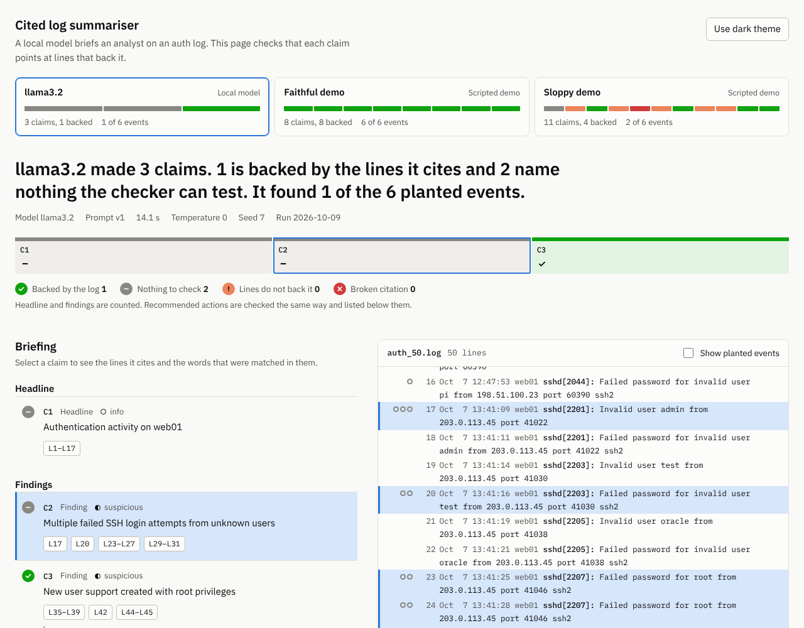
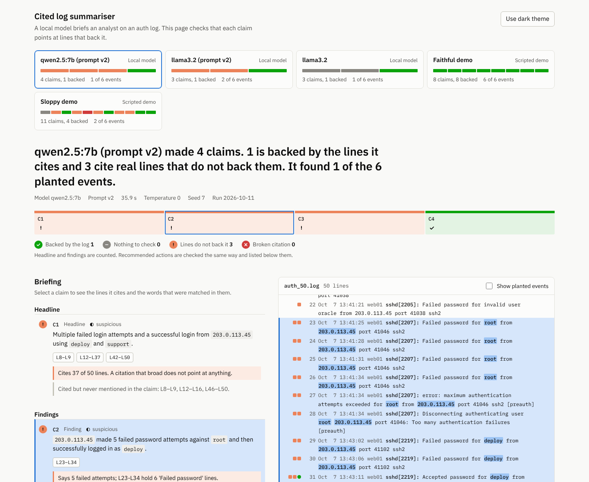
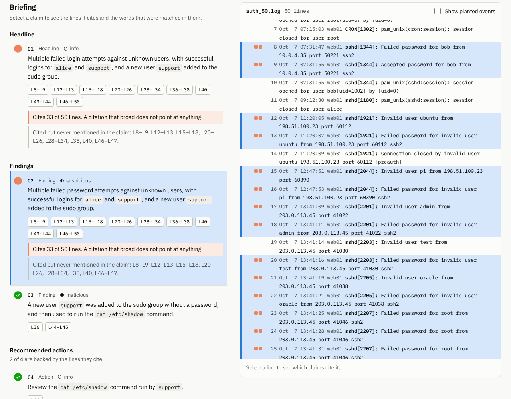
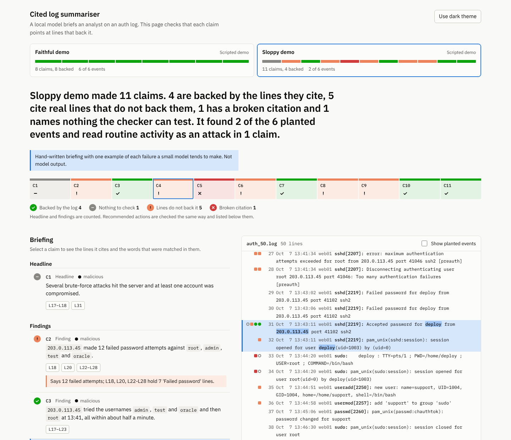

# log-summariser-cited-evidence

A local model writes an analyst briefing from an authentication log, and every claim in it has to cite the log lines that back it. A checker then opens each citation and tests it. A dashboard shows which claims hold up, which only look as if they do, and which planted events the briefing missed.



*The first live run (prompt v1): llama3.2 through Ollama, 14 seconds, nothing edited. It wrote valid JSON and cited real lines, but only one of its three claims names anything the checker can test, and it found one of the six planted events. Claim C2, selected here, says "failed SSH login attempts" and cites a successful login (L31) among the failures. Two more runs, a revised prompt and a larger model, are compared in [Live results](#live-results).*

**Status:** the pipeline, checker and dashboard are complete and tested, and three live runs are kept in `runs/`: `llama3.2` with prompt v1 and v2, and `qwen2.5:7b` with v2. Models larger than 7B, other seeds and other logs have not been tried. See [What has and has not been tested](#what-has-and-has-not-been-tested).

## Why this is worth doing

A summary of a log is only useful if an analyst can trust it quickly. Models invent details: an address that is not in the log, a count that is a little off, a login time that is close but wrong. Asking for line numbers turns every claim into something that can be opened and checked in seconds, and checking it by machine means the opening happens for every claim, not just the ones a reviewer happens to doubt.

Citations on their own can be gamed, so the project measures three things:

- **Are the claims backed?** Every claim must cite lines, and the names, addresses, times and counts it states must be in those lines.
- **Did it find what matters?** The log is written with six planted events, so a briefing that cites correctly but misses the compromise scores badly.
- **Did it over-read?** Routine activity (a mistyped password, a cron job) is marked in the answer key, so a briefing that calls it an attack is flagged even when its citations are fine.

## Start here

No model needed. This writes the log, two scripted briefings, the rules document and the dashboard.

```bash
git clone https://github.com/MuhammadMurtuzaHussain/log-summariser-cited-evidence.git
cd log-summariser-cited-evidence
python3 -m venv .venv && source .venv/bin/activate
pip install -r requirements-dev.txt

python -m citedlog demo       # data, scripted runs, docs, site/index.html
open site/index.html          # macOS; xdg-open on Linux
python -m pytest -q
```

The tool itself uses only the Python standard library. `requirements-dev.txt` adds pytest and ruff.

## With a local model

Install [Ollama](https://ollama.com), pull a model and run:

```bash
ollama pull llama3.2
python -m citedlog summarise --model llama3.2
python -m citedlog dashboard          # rebuild the page so it includes the new run
```

Run these from the project folder. Inside the virtual environment from "Start here" the command is `python`; on a Mac without one, use `python3` (macOS has no `python`).

`summarise` sends the 50 numbered lines to Ollama's `/api/chat` endpoint with a JSON schema, saves the reply to `runs/`, checks it, and prints the verdicts. Try a larger model (a `qwen2.5:7b` run is compared in [Live results](#live-results)) and compare: every run you save becomes a tab on the dashboard. Useful options:

| Option | What it does |
|---|---|
| `--markdown briefing.md` | Also writes the briefing with citations inline, ready to paste |
| `--min-grounding 0.9` | Exits with status 1 if fewer than 90% of claims are backed (a gate for scripts and CI) |
| `--prompt v1\|v2` | Which instructions the model gets. `v1` is the default and is what the first live run used; `v2` asks for specifics and shows one worked example. The run is labelled and stores the version, so two prompts on one model sit side by side on the dashboard |
| `--temperature`, `--seed` | Recorded in the run file so results can be reproduced |
| `--host` | Ollama on another machine; defaults to `$OLLAMA_HOST` or `http://localhost:11434` |
| `--log` | Your own log. Without a `.truth.json` beside it, the planted-event and over-read measures are skipped and the checker still runs |

`python -m citedlog verify runs/<file>.json` re-checks a saved run, for example after changing a rule. Run files hold only what the model said; verdicts are worked out again each time.

Console output (scripted sloppy briefing, abridged):

```
  C2  finding   malicious  UNSUPPORTED L18, L20, L22-L28
        `203.0.113.45` made 12 failed password attempts against `root`, `admin`, `test` and `oracle`.
        ! Says 12 failed attempts; L18, L20, L22-L28 hold 7 'Failed password' lines.

  C5  finding   malicious  INVALID     L33-L34, L57
        After getting a root shell, `deploy` installed a persistence mechanism.
        ! Cites L57; the log runs from L1 to L50.

Sloppy demo made 11 claims. 4 are backed by the lines they cite, 5 cite real lines that do not back them,
1 has a broken citation and 1 names nothing the checker can test. It found 2 of the 6 planted events and
read routine activity as an attack in 1 claim.
```

## Live results

Three runs through Ollama on the same log at temperature 0 and seed 7: `llama3.2` with prompt v1 and v2 on 9 October 2026, and `qwen2.5:7b` with prompt v2 on 11 October. All three are committed in `runs/` with the model's reply exactly as received ([llama v1](runs/20261009-142852-llama3.2.json), [llama v2](runs/20261009-151525-llama3.2.json), [qwen](runs/20261011-083227-qwen2.5-7b.json)).

| | llama3.2, prompt v1 (14.1 s) | llama3.2, prompt v2 (16.4 s) | qwen2.5:7b, prompt v2 (35.9 s) |
|---|---|---|---|
| Valid JSON, every line number inside the log | Yes | Yes | Yes |
| Claims about the log (headline and findings) | 3 | 3 | 4 |
| Backed by the lines they cite | 1 | 1 | 1 |
| Nothing to check | 2 | 0 | 0 |
| Lines do not back it | 0 | 2, each citing 33 of the 50 lines | 3: a 37-line citation, a miscount, an attribution the cited lines do not show |
| Planted events found | 1 of 6 (the `support` account) | 2 of 6 (the account and the `/etc/shadow` read) | 1 of 6 (the `/etc/shadow` read) |
| Names the account and the command | No: nothing in backticks | Yes: `support`, `alice`, `cat /etc/shadow` | Yes: `support`, `/etc/shadow` |
| Names the attacker's address and the `deploy` login | No | No | Yes: `203.0.113.45`, `deploy` |

What the runs show:

- **Prompt v2 got llama to name things.** v1 wrote nothing the checker could test. v2 names the account and the command, so the checker could test them, and the one narrowly cited claim passed and earned credit for two events.
- **llama ignored "one claim per event".** Its headline and first finding are the same sentence, merging the failed logins, two successful logins and the new account, and citing 33 of 50 lines. The checker marks both as not backed, because a citation that broad points at nothing.
- **The larger model writes the story, and the checker finds the errors in it.** qwen is the first to name the attacker's address and `deploy`, and it tells the incident in order: the failed logins, the `deploy` login, the `support` account, the `/etc/shadow` read. That is four of the six events described, but only one of them sits in a claim that holds up, so only one earns credit. The other three claims failed on different rules (below).
- **More specific claims score lower here.** qwen's grounding is 1 of 4, against 1 of 3 for both llama runs. A vague claim ("suspicious activity was observed") gives the checker nothing to disprove, and a specific one can be wrong. This is a point about what the measure rewards, and it is why the planted-events score and the grounding rate are reported together.
- **Each qwen failure is a different kind.**
  - C1, the headline, cites 37 of 50 lines, so it points at nothing.
  - C2 says 5 failed attempts against `root`. The cited lines hold 4 against `root` (6 once the two against `deploy` are included, and the claim names both accounts), so it is wrong on either reading.
  - C3 says `deploy` created `support` but cites only L35-L37, which never mention `deploy`. The claim is probably true, because L33-L34 show `deploy` opening a root shell 31 seconds earlier, but the model did not cite them. "Not backed" means the cited lines do not show it, not that the claim is false.
- **A claim the checker passed says something the log does not show.** llama's backed finding says `support` was added to the sudo group "without a password". L37 shows a password being set for the account. The checker tests names, times and counts, not what the words around them assert, so it passes. See [Limits](#limits).
- **Still missed by every run:** the slow probe from `198.51.100.23` (E1) and the root shell (E4). No run earns credit for the brute force or the `deploy` login (E2, E3). The llama runs mention failed logins only as coming from "unknown users", and qwen names the address and the account, but the claims carrying them did not hold up.

This is three runs of two small models at one seed, so it is an anecdote, not a benchmark. The useful result is that the checker separated the briefings and said why each claim failed. A revised prompt moved the evidence but not the headline rate, and a larger model moved the story but not the headline rate either.

Three changes were made along the way:

1. **Scoring was tightened after the first run.** The claim "New user support created with root privileges" had been credited with two events: the account (E5) and the attacker's return as `support` to read `/etc/shadow` (E6). It cited some of E6's lines and used the word `support`, which both events share. E6 now needs the word `shadow`, and the first run was re-scored from 2 of 6 events to 1 of 6. The rule was changed after seeing the result, so the earlier number was the checker being too generous. The llama v2 run earns E6 properly: its claim names `/etc/shadow` and cites L44.
2. **Prompt v2 was written in response.** It adds two rules (name who did what; one claim per event) and a three-line worked example from a different log. The example uses an address and usernames that appear nowhere in the scenario, and a test checks that it is itself a briefing the checker passes.
3. **The count rule was narrowed after the qwen run.** It used to compare "N failed attempts" with every failed password in the cited span, so a claim about `root` was judged against failures for other accounts. It now counts only the addresses and users the claim names. qwen's verdicts did not change, but the old rule would have wrongly failed a correct claim about `root` alone and wrongly passed some wrong ones.



*qwen2.5:7b with prompt v2, claim C2 selected. The attacker's address and both accounts are named and highlighted in the cited lines, and the count is what fails.*



*llama3.2 with prompt v2, headline selected. Its citation covers 33 lines, so the checker says it points at nothing in particular.*

## How a claim is judged

Each claim gets one of four outcomes. The checker uses string matching only, never a second model, so the same claim always gets the same verdict.

| Outcome | Meaning |
|---|---|
| Backed by the log | Every line exists, and every address, username, time and count in the claim is in the cited lines |
| Nothing to check | The lines exist, but the claim states nothing the checker can test ("several attacks hit the server") |
| Lines do not back it | The lines exist, but the claim states something that is not in them |
| Broken citation | No line numbers, malformed numbers, or a line past the end of the log |

The rules behind those outcomes (invented addresses, wrong times, miscounts, "never succeeded" claims that the rest of the log contradicts, citing half the log to satisfy everything) are listed with what each one cannot catch in [docs/verifier-rules.md](docs/verifier-rules.md), which is generated from the code.



*A scripted demo briefing (hand-written, not model output) showing a failed check. Claim C4 gives a time, 13:52:11, that is not in the lines it cites, so the checker marks it unsupported. The address and username it does cite are highlighted in the log.*

## The log and the answer key

[`data/auth_50.log`](data/auth_50.log) is 50 lines of OpenSSH, sudo, PAM and cron output from one host, written as a short story: a quiet morning, a slow probe, a brute-force burst, a guessed password, a root shell, a new backdoor account, and the attacker returning. [`data/auth_50.truth.json`](data/auth_50.truth.json) lists the six planted events and the routine lines. Both are generated from the same tagged scenario in `citedlog/scenario.py`, so the answer key cannot drift from the log. The addresses are from the documentation ranges reserved for examples (RFC 5737).

## Design choices worth talking about

- **Line numbers as the contract.** The model sees `[17] Oct  7 13:41:09 ...` and returns `lines: [17, 18]` in a JSON schema enforced by Ollama. The claim text is asked to put names, addresses and commands in backticks, which gives the checker exact strings to look for.
- **A deterministic checker, not a judge model.** A second model grading the first would add a second source of the same errors. String matching is limited but predictable, and every failure comes with the reason in plain words.
- **"Nothing to check" is its own outcome.** A claim with no names, times or counts cannot fail a string match, so passing it would flatter vague summaries.
- **Absence needs the whole log.** "No successful login from X" cannot be shown by citing lines, so those claims are checked against every `Accepted` line.
- **Coverage counts only backed claims that use a word identifying the event.** A fluent, invented version of an event earns nothing, and sharing a username with a later event is not enough: the first live run showed that `support` alone credited an account-creation claim with the later `/etc/shadow` read.
- **Actions are checked but kept out of the headline rate.** A recommendation has to cite what motivates it, but the grounding rate measures statements of fact.
- **Model output is stored untouched.** Wrong line numbers stay wrong, so the checker sees exactly what was said.

## Limits

- **A pass is evidence, not truth.** A claim can cite the right lines, with every name and time correct, and still read them badly. "This is a brute-force attack" passes if it cites the failed-login lines. Judgement stays with the analyst; the checker makes the evidence quick to open.
- **What the words say is not tested.** The checker tests names, addresses, times and counts, not verbs or negations. A claim that says "failed attempts" can cite an accepted login among the failures, and one that says a user was added "without a password" passes when the log shows the password being set. Both happened in the live runs: v1's C2 cites L31 (an accepted login), and v2's C3 is marked backed with that unsupported phrase in it. The first was "nothing to check" anyway; the second earned credit for two planted events.
- **Counts follow the names in the claim, with a gap.** "5 failed attempts against `root`" is compared with the failures against `root` in the cited lines, not with every failure in the span. If a claim also names an account only for what happened next, such as `deploy` logging in after the failures, failures against that account widen the count. The count rule was tightened this way after the qwen run, where counting every failure in a span would have mis-scored claims about a single account.
- **Usernames are known only from the log.** An invented username is caught if it is in backticks or follows "named" or "called". A made-up name written bare in a sentence is not.
- **One log, one story.** Fifty lines is a deliberate starting size. Scores on it say little about a million-line file, long context or other log formats.
- **Common words as usernames.** A user called `test` or `support` can trip the name check when the claim uses the word in its ordinary sense. The failure message names the exact term, so it is quick to judge.
- **Small samples.** One run at temperature 0 is one run. Compare several models and seeds before drawing conclusions.

## What has and has not been tested

- **Tested:** the checker (every rule, boundary cases including counts scoped to an address or account, and mutation checks that weaken each rule to confirm a test fails), parsing of messy model replies, the Ollama client against a stand-in HTTP server (request shape, missing model, server down, timeout, error replies), the command line end to end, drift between committed files and the code that generates them, the three committed live runs (what the checker makes of each is pinned by tests), the prompt (v2's example is a briefing the checker passes and shares nothing with the scenario), and the dashboard in headless Chromium (light, dark, phone width, keyboard, scripts off, hostile log and model text). The suite runs on Python 3.10, 3.12, 3.13 and 3.14.
- **Run live three times:** `llama3.2` with prompt v1 and v2, and `qwen2.5:7b` with v2, one log, one seed. See [Live results](#live-results).
- **Not yet tested:** models larger than 7B, other seeds, and any log other than this one. The checker's reading of a model's claims is only as good as the claims the models make, so each new model may expose a rule that needs tightening, as the first run did.
- **Scripted runs are hand-written.** `demo-faithful` and `demo-sloppy` are examples of good and bad briefings, labelled as such everywhere they appear. They are not evidence about any model.

## If you point this at real logs

Authentication logs contain personal data: usernames, source addresses, sometimes names. Running the model locally keeps that data on your own machine, which is the reason to use Ollama here rather than a hosted API. Before using real logs, agree retention and access, redact what the briefing does not need, and keep the dashboard file, which embeds the log, inside the same boundary as the log itself.

An evidence-linked summary supports, but does not satisfy, the logging and monitoring expectations in ISO/IEC 27001:2022 Annex A 8.15 and 8.16, the assessment and response of security events in A.5.25 and A.5.26, and NIS2 Article 21(2)(b) on incident handling. The checker's output is a useful record of how far a machine-written summary was verified before someone relied on it, for example when assembling an early warning under NIS2 Article 23.

## Layout

```
citedlog/scenario.py       the 50-line log and its answer key
citedlog/prompt.py         the instructions (versions v1 and v2) and the JSON schema sent to the model
citedlog/backends.py       Ollama client (standard library) and the scripted demos
citedlog/briefing.py       parses a model reply into claims without correcting them
citedlog/verify.py         the rules, the four outcomes and the scoring
citedlog/runs.py           run files, scoring, and the one-paragraph reading
citedlog/dashboard.py      builds the single-file page; web/ holds its HTML, CSS, JS and fonts
citedlog/cli.py            generate, summarise, verify, dashboard, docs, demo
data/                      the log and the answer key (generated)
runs/                      saved model replies (the two demos and the three live runs are committed)
docs/verifier-rules.md     generated from the code
tests/                     checker, backends, command line, dashboard, drift
```

The dashboard is one HTML file with its fonts, styles and script inlined. It makes no network requests, and log text and model output are inserted as plain text only.

## Ideas to extend it

- Run a larger model (`qwen2.5:7b`, say) with prompt v2 and compare it with the two `llama3.2` runs on the dashboard tabs.
- Enforce "one claim per event": flag a claim whose citation spans lines from several planted events or several unrelated sources.
- Check what the words claim: "failed" should cite failed lines, "accepted" an accepted login, and "without a password" should be tested against the password lines (both live runs show why).
- Run several models and seeds and chart grounding rate against model size.
- Ask the model to cite the specific words in each line, and check those too.
- Add a second log with a different story (web server, VPN) to test the prompt beyond sshd.
- Chunk a long log, brief on each chunk, and check that line numbers survive the merge.
- Add a "claims per planted event" view, to show which events attract duplicate claims.

## Licence

MIT. IBM Plex fonts are bundled under the SIL Open Font License 1.1; the licence text is in `citedlog/web/fonts/`.
